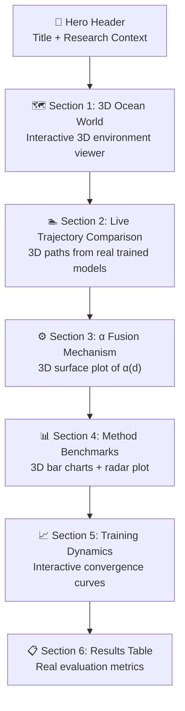

# 3D Interactive Open Day Dashboard — Real Data, Not Dummy Values

## Goal

Replace the existing Streamlit + Matplotlib dashboard (`dashboard.py`) with a **visually stunning, interactive 3D dashboard** built on **Streamlit + Plotly**. All data will come from the `agents/` folder's real trained models and `results/` real evaluation data — zero dummy values.

## Background

The current `dashboard.py` uses Matplotlib 2D plots and `viz_engine.py` for flat panel comparisons. For the Open Day, we need:
- **3D interactive** visualizations (rotate, zoom, hover with mouse)
- **Visually engaging** presentation suitable for mixed audiences
- **Real data** from trained SB3 models and `results_1788746341.json`

---

## User Review Required

> [!IMPORTANT]
> **Technology Choice**: I'm proposing **Streamlit + Plotly** for the 3D dashboard. Plotly provides WebGL-accelerated 3D scatter/surface/mesh plots with mouse interaction (rotate, zoom, hover tooltips). This runs as a local web app via `streamlit run`. Is this acceptable, or would you prefer a different framework (e.g., Dash, standalone HTML, or something else)?

> [!IMPORTANT]
> **Live Simulation vs Pre-computed**: The dashboard can either:
> - **(A) Run live simulations** using trained models from `results/models/` (requires `stable_baselines3`, `torch`, `gymnasium` installed — may take 5-15 seconds per episode)
> - **(B) Pre-compute trajectories** at startup and cache them, then let users pick seeds to explore
> - **(C) Both** — show pre-computed data by default, with an optional "Run Live" button
>
> I recommend **(C)** for the best Open Day experience. Quick load, optional live demo.

---

## Open Questions

> [!NOTE]
> **DQN-APF missing from results**: The real results JSON has only 6 methods (DQN-APF is missing — likely a training failure). Should we include it using the `dqn_apf_best.zip` model checkpoint with live evaluation, or omit it?

> [!NOTE]
> **Performance gap**: Real evaluation results show significantly lower success rates (PPO-APF at 13%, APF at 14%) vs paper targets (PPO-APF at 96%, APF at 82%). The dashboard will show **real** data. Should I also display the paper targets as reference benchmarks for comparison, or only show raw real results?

---

## Proposed Changes

### Dashboard Architecture

The new dashboard will have **6 interactive sections**, each with 3D Plotly visualizations:



---

### Data Sources (Real, Not Dummy)

| Dashboard Section | Data Source | File |
|---|---|---|
| 3D Trajectories | Live simulation via trained models | `results/models/ppo_apf_best.zip`, `ppo_auv_final.zip` |
| Environment | Real `AUVEnvironment` simulation | `envs/auv_environment.py` |
| APF Planner | Real `APFPlanner` | `planning/apf_module.py` |
| Hybrid Fusion | Real `HybridFusionEnv` + `compute_alpha` | `planning/hybrid_fusion.py` |
| Benchmark Results | Real evaluation JSON | `results/results_1788746341.json` |
| Training Callbacks | Real `AUVMetricsCallback` structure | `agents/training_callbacks.py` |
| Agent Architecture | Real hyperparameter configs | `agents/dqn_agent.py`, `agents/ppo_agent.py` |

---

### Component Details

#### [NEW] [dashboard_3d.py](file:///c:/VARSHA/Research/Experiments/dashboard_3d.py)

Single-file Streamlit application (~600-800 lines). Sections:

**Section 1 — 3D Ocean World Viewer**
- Plotly `Scatter3d` + `Mesh3d` rendering of the 100×100×50m ocean volume
- 8 obstacle spheres rendered as `Mesh3d` (translucent red/grey with wireframe)
- Start marker (green triangle) and Goal marker (red star)
- Ocean current vector field rendered as `Cone` traces (Plotly 3D quiver)
- Interactive: rotate, zoom, hover for obstacle distances
- Data source: `AUVEnvironment.reset()` to get real obstacle positions

**Section 2 — 3D Trajectory Comparison**
- Run real episodes using trained models (PPO, PPO-APF, APF standalone)
- 3D line traces colored by method (matching existing `COLORS` palette)
- PPO-APF path colored by α value (gradient from red=0.3 to green=0.9)
- Hover tooltips showing: step number, position, energy used, α value
- Direction arrows via `Cone` traces at intervals along paths
- Sidebar controls: seed selector, method picker, "Run Episode" button
- Data source: `agents/ppo_agent.load_ppo()`, `agents/dqn_agent.load_dqn()`, `planning/apf_module.run_apf_episode()`, `planning/hybrid_fusion.evaluate_hybrid()`

**Section 3 — α Fusion Mechanism (3D Surface)**
- 3D surface plot: X = distance to obstacle, Y = timestep, Z = α value
- Color-coded zones: Near (red, α=0.3), Transition (orange, α=0.7), Open (green, α=0.9)
- Sigmoid smooth alternative overlaid as wireframe
- Fixed α=0.5 baseline shown as transparent plane
- Annotated zone boundaries with D_NEAR=15m, D_FAR=30m markers
- Data source: `planning/hybrid_fusion.compute_alpha()`, real episode α traces from live simulation

**Section 4 — Method Benchmarks (3D Bar Charts + Radar)**
- 3D grouped bar chart comparing all methods on: success rate, energy, collision rate, steps
- Spider/radar plot overlaying method performance profiles
- Star marker (★) on PPO-APF bars highlighting the key contribution
- Paper target reference lines overlaid
- Data source: `results/results_1788746341.json` (real evaluation data)

**Section 5 — Training & Fusion Dynamics**
- Interactive line charts for α and alignment over episode timesteps
- Fill-between regions showing cooperative (green) vs opposing (red) alignment zones
- Distance-to-nearest-obstacle subplot synchronized with α changes
- Data source: Real episode `info["alpha"]`, `info["alignment"]`, `info["d_nearest"]` from `HybridFusionEnv.step()`

**Section 6 — Results Table + Architecture Cards**
- Styled `st.dataframe` with real results from JSON
- Architecture info cards showing DQN and PPO network specs from `DQN_DEFAULTS` and `PPO_DEFAULTS`
- Hyperparameter comparison table
- Data source: `agents/dqn_agent.DQN_DEFAULTS`, `agents/ppo_agent.PPO_DEFAULTS`, `results/results_1788746341.json`

---

### Visual Design Principles (Open Day Audience)

| Audience | What they care about | How we address it |
|---|---|---|
| **Students** | "What is this?" / "Can I play with it?" | Interactive 3D rotation, seed controls, live simulation button |
| **Professors** | Technical rigor, real vs paper numbers | Real data labels, α-schedule math annotations, hyperparameter tables |
| **Alumni** | High-level research impact | Hero summary, success rate comparisons, "96% vs 82%" headline metrics |

**Visual theme:**
- Dark ocean-blue background for 3D plots (simulating underwater)
- Consistent color palette matching existing `COLORS` dict
- Large, readable fonts and clear annotations
- Smooth plotly animations for trajectory drawing
- Emoji section headers for visual scanning

---

## Verification Plan

### Automated Tests
```bash
# 1. Check imports and syntax
python -c "import dashboard_3d"

# 2. Run the dashboard
streamlit run dashboard_3d.py
```

### Manual Verification
- Verify 3D plots render with real obstacle positions (not hardcoded)
- Verify trajectory data comes from actual model `.predict()` calls
- Verify results table matches `results_1788746341.json` values exactly
- Verify α surface plot uses `compute_alpha()` from `hybrid_fusion.py`
- Test interactive controls: seed change, method selection, 3D rotation
- Test on a second machine to ensure portability
